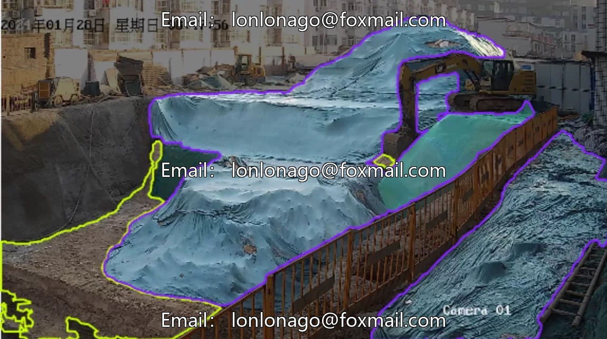
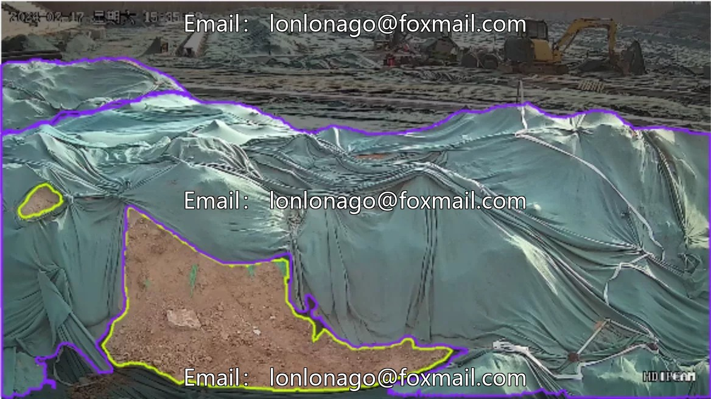
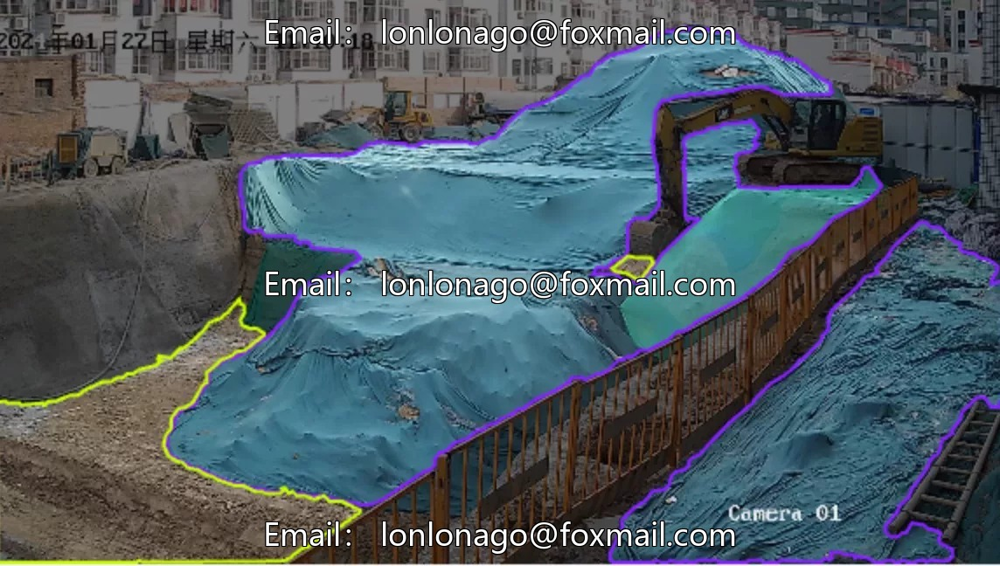
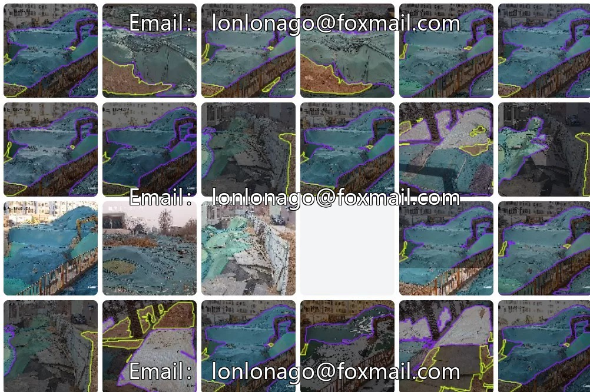
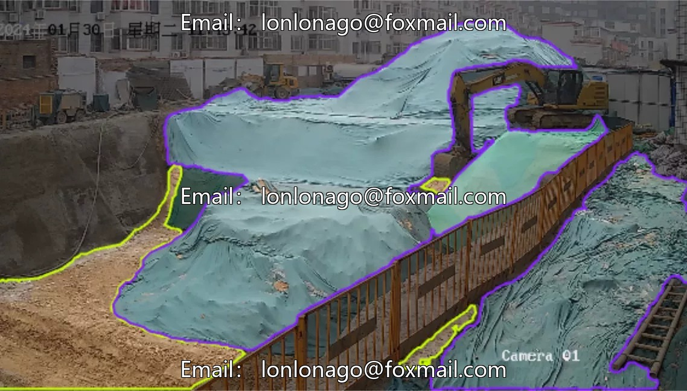

# Intelligent construction site soil coverage detection dataset, bare soil image segmentation dataset, construction site environmental awareness dataset.

## Body

Intelligent Construction Site Land Cover Dataset, Bare Soil Image Segmentation Dataset, Construction Site Environmental Protection Identification, Bare Soil Covered with Green Nets, Construction Site Monitoring Image Dataset, AI Image 10195 Issue

The dataset consists of 96 images with a resolution of 1920x960, labeled as "baresoil" and "mubu", belonging to the category of instance segmentation datasets in the field of computer vision. It is suitable for research related to visual recognition of bare soil, such as land cover monitoring, environmental ecological assessment, etc., providing basic data for model training.

The data format is an image file, supporting the upload of test models to evaluate their effects. The data volume is moderate, with precise annotations, suitable for initial research or model validation.

Virtual materials, once sold, are non-refundable.
Interested friends, click "I want" to proceed.

## Images

## Payment

Here is a pay link on Stripe ( https://buy.stripe.com/3cs8yP7sY87d0vu9AB ). Please contact me lonlonago@foxmail.com after funding $89, and I will send you a complete data files , thank you!

